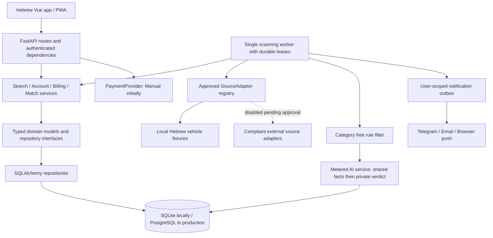
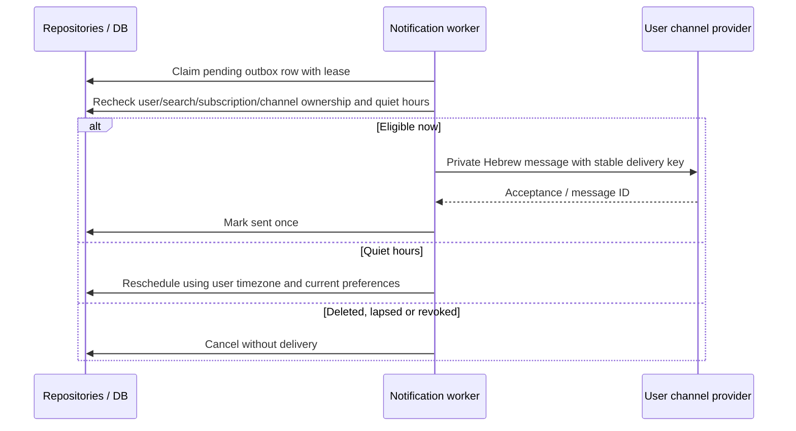

# Hebrew Deal Alerts SaaS: Orientation and Proposed Plan

Last verified: 2026-11-09. Status: owner-approved Phase 5.1 implemented and offline
gate passed (164 tests). Stopped for Phase 5.2 approval; no database migration,
customer accounts, external listing access or production deployment yet.

Phase 5.0 originally changed only this document. The owner subsequently approved
the two baseline repairs and demo-only Phase 5.1. Section 2 records the original
code map; Section 8.2 records the implemented delta and exact demo commands.
Every subsequent phase ends with passing tests, a short explanation and runnable
commands, then an approval stop. Implementation status is tracked in
[the project tracker](../.claude/project-tracker.md).
The original [LICENSE](../LICENSE) and [DISCLAIMER.md](../DISCLAIMER.md) remain intact.

## 1. Scope and Working Defaults

Build a private Hebrew, RTL subscription service, initially for small vehicle
dealers in Israel. Customers save searches and receive private alerts linking to
original listings. No public listing catalogue, public image archive, or public
match pages. Real estate and second-hand goods will be category plug-ins, not
separate engines. One customer account is one tenant; dealer teams are not in scope.

| Owner decision | Default until answered | Needed by |
| --- | --- | --- |
| Which sources do we have permission to read automatically? | None; local DemoAdapter only | Any real adapter, including Xianyu |
| Which payment provider? | Admin-managed manual activation | Phase 5.4; hosted provider stays conditional |
| Which AI provider and model? | OpenAI-compatible endpoint and model configured in environment; no hard-coded vendor | Phase 5.5 live AI acceptance |
| Product name and domain? | Configured `APP_NAME` placeholder; no assumed domain | Branding, email links, HTTPS deployment |
| Launch notification channels? | Telegram and email | Phase 5.6; browser push remains in planned scope |

Owner preference: **Yad2 is the desired first real vehicle source**. No permission,
approved API or data-feed agreement has been supplied. Review of the privacy
policy did not establish permission for third-party automated collection; terms
of use and a provider-approved access arrangement still need review. No Yad2
adapter is installed or enabled. The other defaults above remain unchanged.

Source permission and robots compliance are separate requirements. Neither a
public page nor an allowing robots rule constitutes owner approval. Answers do
not automatically approve the next phase. No paid vendor, budget, or delivery
date is assumed agreed.

## 2. Current Code Map: What Actually Exists

The code is ahead of some README descriptions: SQLite is already the default for
tasks/results/price snapshots, with legacy JSON/JSONL import and file-shaped APIs.
It is not a blank JSON-only persistence migration.

| Area and evidence | Current responsibility | Proposed disposition |
| --- | --- | --- |
| [app.py](../src/app.py) | FastAPI routes, SQLite bootstrap, global process/scheduler/generation services, startup task reset, static files and SPA | Keep web entry; move scanning ownership to worker; authenticated dependencies; migrations outside startup |
| [spider_v2.py](../spider_v2.py) | Reads all tasks or named task, requires marketplace login state, loads prompt files, directly calls `scrape_xianyu` | Retain as generic worker/CLI entry where practical; no implicit live-source default |
| Former `src/scraper.py`; now [disabled Xianyu boundary](../src/infrastructure/sources/xianyu/__init__.py) | Originally browser search/detail/profile collection, account/proxy handling and dispatch | Legacy browser implementation removed in 5.1, not preserved behind an enable flag |
| [Xianyu parsers](../src/infrastructure/sources/xianyu/parsers.py), formerly `src/parsers.py` | Goofish API payloads, seller ratings/profile data, Chinese output keys, CNY and deep-link conversion | Moved with fixture tests to adapter ownership; not imported by generic scanning |
| [ai_handler.py](../src/ai_handler.py), [ai_message_builder.py](../src/ai_message_builder.py), [prompt_utils.py](../src/prompt_utils.py) | Legacy AI execution, image download/cleanup, criteria generation and notification wrapper | Consolidate neutral logic into existing AI service/client; delete dead wrappers after callers move |
| [api routes](../src/api/routes), [dependencies.py](../src/api/dependencies.py) | Tasks, generation jobs, dashboard, results/exports, logs, settings, prompt editing, marketplace cookies, WebSockets | Customer search/match/account/billing APIs; separate admin capabilities; remove marketplace-cookie routes from SaaS |
| [task.py](../src/domain/models/task.py), [TaskRepository](../src/domain/repositories/task_repository.py), [task_service.py](../src/services/task_service.py) | Pydantic task models and unscoped CRUD | Evolve into user-owned searches and scoped repository contracts, preserving layer direction |
| [scheduler_service.py](../src/services/scheduler_service.py), [process_service.py](../src/services/process_service.py) | Shanghai-time cron jobs, one scraper subprocess per task, process maps and log files | Worker-owned due-time polling with durable leases; shared query fetches instead of per-customer subprocesses |
| [item_analysis_dispatcher.py](../src/services/item_analysis_dispatcher.py) | Concurrent seller loading, either keyword OR AI decision, save, then notification | Always free rules before AI; shared fact extraction, private verdicts, transactional outbox |
| [ai_service.py](../src/services/ai_service.py), [ai_client.py](../src/infrastructure/external/ai_client.py), [AI compatibility helpers](../src/services/ai_request_compat.py), [response parser](../src/services/ai_response_parser.py) | Another AI path with provider compatibility and legacy verdict validation | Reuse compatibility code; one strict schema and metered AI gateway, not two analysis pipelines |
| [notification_service.py](../src/services/notification_service.py), [notification clients](../src/infrastructure/external/notification_clients) | Fan-out to globally configured ntfy/Bark/WeCom/Telegram/PushPlus/Gotify/webhook destinations | Reuse transport interfaces where suitable; per-user destinations; Telegram/email/push adapters |
| [result_storage_service.py](../src/services/result_storage_service.py), [price_history_service.py](../src/services/price_history_service.py) | Direct SQLite queries, filename/keyword grouping, deduplication and market summaries | Move persistence into repositories; shared listings/history, private matches, category-specific comparables |
| [dashboard_service.py](../src/services/dashboard_service.py), [result export](../src/services/result_export_service.py), [blacklist rules](../src/services/result_blacklist_service.py) | Aggregates, CSV, per-result-file visibility rules | Reuse transformations after scoping; search exclusions replace global file-based rules |
| [task_generation_service.py](../src/services/task_generation_service.py), [runner](../src/services/task_generation_runner.py) | In-memory generation jobs and keyword-derived criteria files | Owner-scoped structured-filter drafts; explicit confirmation; no shared prompt file writes |
| [SQLite connection](../src/infrastructure/persistence/sqlite_connection.py), [bootstrap](../src/infrastructure/persistence/sqlite_bootstrap.py), [task repository](../src/infrastructure/persistence/sqlite_task_repository.py), [JSON repository](../src/infrastructure/persistence/json_task_repository.py) | Hand-written schema, metadata migrations/imports, unscoped queries | SQLAlchemy 2 repositories and Alembic; explicit offline legacy import only |
| [config.py](../src/config.py), [settings.py](../src/infrastructure/config/settings.py), [env manager](../src/infrastructure/config/env_manager.py) | Two config paths, global AI/destinations, source constants, editable environment | One typed server config; customer preferences in DB; never return secrets through settings APIs |
| [Vue router](../web-ui/src/router/index.ts), [useAuth](../web-ui/src/composables/useAuth.ts), [HTTP helper](../web-ui/src/lib/http.ts) | Dashboard/tasks/results/accounts/logs/settings routes; localStorage login state | Preserve Vue structure; session-backed account state; distinct public/customer/admin routes |
| [i18n](../web-ui/src/i18n/index.ts), [layouts](../web-ui/src/layouts), [components](../web-ui/src/components) | Chinese/English localization, shadcn-vue/Reka UI, Lucide, task forms, price chart | Hebrew default and RTL; reuse primitives/chart after data-contract changes |
| [tests](../tests), [pyproject.toml](../pyproject.toml) | pytest unit/integration fixtures and explicitly opt-in live tests | Preserve offline regression tests; add tenant, source-policy and concurrency coverage in owning phases |
| [Compose](../docker-compose.yaml), [image workflow](../.github/workflows/docker-image.yml), [start.sh](../start.sh), [desktop launcher](../desktop_launcher.py) | Single app container with local mounts, upstream image default, image publication, local launcher | Fork-owned pinned images, app/PostgreSQL/worker and backup; no production desktop dependency |

### 2.1 Xianyu-Specific Inventory

- Browser/API coupling: Goofish search/detail endpoints, page selectors, pagination,
  Chinese region hierarchy, login redirects, seller profiles/ratings and credit
  fields in scraper/parsers, [search pagination](../src/services/search_pagination.py)
  and [seller cache](../src/services/seller_profile_cache.py). Here `user_id` means
  a marketplace seller, not a SaaS tenant.
- Authentication to the source: `xianyu_state.json`, `state/`, per-task
  `account_state_file`, account strategies, [accounts route](../src/api/routes/accounts.py),
  [login-state route](../src/api/routes/login_state.py),
  [AccountsView](../web-ui/src/views/AccountsView.vue),
  [chrome extension](../chrome-extension), and the root login-state privacy page.
  The existing Accounts screen is NOT customer account management.
- Evasion-related legacy behavior: account/proxy rotation in
  [rotation.py](../src/rotation.py) and
  [account_strategy_service.py](../src/services/account_strategy_service.py),
  browser environment/header imitation, automation-hiding launch flags and
  `navigator.webdriver` override in scraper. Do not retain these as executable
  features of the new product, even inside a disabled adapter.
- Source-shaped data: Chinese dictionary keys throughout parser, dispatcher,
  AI builders, results DTOs/exports and notification formatting; CNY prices,
  `fleamarket://` URLs and `convert_goofish_link` in [utils.py](../src/utils.py)
  and [notification base](../src/infrastructure/external/notification_clients/base.py).
- Source-shaped controls: shipping, personal seller, publish-time options,
  page counts, cookie selection, Goofish regions in
  [TaskRegionSelector.vue](../web-ui/src/components/tasks/TaskRegionSelector.vue),
  desktop/mobile link conversion and rotation settings.
- Prompts and branding: [base prompt](../prompts/base_prompt.txt),
  [MacBook criteria](../prompts/macbook_criteria.txt), generated criteria files,
  Xianyu header strings, translations, test fixtures, config examples and docs.
- Operational assumptions: Shanghai scheduler/failure-guard timezone, browser
  installations in Docker, cookie mounts and live smoke scripts. Retain useful
  fixture tests inside adapter ownership; never run live smoke by default.

### 2.2 Single-User Assumptions and Security Boundaries

- `/auth/status` compares global environment credentials but issues no session.
  `useAuth` trusts `auth_logged_in` in localStorage. The inspected task routes
  have no authenticated-user dependency, and app wiring adds no auth middleware.
  This is not a secure multi-user foundation; do not expose this version publicly.
- Task repository operations use `find_all()` and ID-only reads/writes. No tenant
  ownership exists in the current tables. SQLite task IDs use `MAX(id) + 1`.
- SQLite `tasks`, `result_items`, `price_snapshots`, `result_blacklist_rules` and
  `app_metadata` have no SaaS owner. Results dedupe by filename/link key; snapshots
  group by keyword/run/item. Raw JSON bundles listing, seller and private verdict.
- Prompt, result, image, failure state and log paths use task names/keywords, which
  can collide across customers. Exports, logs, settings and dashboard aggregate
  this global data. Service modules directly execute SQL, outside repository scope.
- `/ws` accepts connections without authentication and broadcasts through one
  global set. Global generation jobs, process maps and scheduler reloads also
  lack customer ownership. Multiple web processes would duplicate scheduling.
- Notification destinations and API keys are global environment settings. The
  dispatcher notifies after saving without a durable per-owner delivery key.
- Keyword matching is an alternative to AI, not a compulsory first stage.
  `SKIP_AI_ANALYSIS` currently recommends directly. No per-customer token ledger,
  subscription limits, verification/reset flows or payment events exist.
- `/static` is publicly mounted. Sensitive generated images/screenshots must not
  live under public static roots. The SPA catch-all must not disguise API 404s.
- The frontend has no Hebrew locale, RTL direction setting, customer billing,
  onboarding or PWA implementation; its package scripts have no UI test command.

## 3. Target Architecture

Principles: collect once, decide privately; deny access unless explicitly allowed;
use durable state for money, scheduling and notifications.



Keep API -> services -> domain -> infrastructure. Routes validate Pydantic input
and obtain the authenticated identity; repositories enforce ownership in SQL for
every read, write, list, join, aggregate and delete. Domain interfaces must not
import SQLAlchemy, FastAPI or source implementations. Existing service modules
are evolved, not duplicated into a second application. New packages are justified
for source/category plug-ins, account/billing domains, and migrations.

### 3.1 Sources and Categories (Phase 5.1)

Define async `SourceAdapter.search(query) -> list[ListingSummary]` and
`fetch_details(listing_id) -> Listing`. Metadata: stable source key, display name,
supported category keys, approved host allowlist, minimum request interval,
maximum concurrency and adapter version. Summaries contain source/external ID,
category, canonical original URL, title, optional price/currency/region,
published time, available structured fields and a main image reference.
Details add necessary description, bounded photo references and typed fields.

Domain contracts live under `src/domain`; adapters under
`src/infrastructure/sources/{demo,xianyu}` (proposed paths). Generic services
depend only on contracts. Only the composition root loads an allowlisted adapter;
the core has no Xianyu imports. Category registry entries own their Pydantic field
schema, filter schema, deterministic matching, comparables selection, and prompt
template. Future categories require a plug-in and registration, not changes to
worker, billing, repository ownership or notification logic. Generic structured
form metadata lets the UI render future category fields without a core switch.

Vehicle fields: `make`, `model`, `year`, `km`, `hand` (Israeli ownership ordinal,
1 means first hand), `price`, `currency`, `region`, optional `seller_type`,
`fuel_type`, `transmission`. Unknown is null, never zero or an invented fact.
Filters: included/excluded keywords, price/year/km ranges, maximum hand,
make/model, regions and permitted seller types. Use stable codes with Hebrew
labels, integer agorot for ILS and a versioned filter schema.

Demo fixtures use fictional Hebrew vehicles, local licensed/synthetic images,
reserved `.invalid` original links, stable IDs and `available_after_seconds`.
An injected clock and configured epoch make new listings appear over time
without sleeping in tests. Fixture content cannot be mistaken for live inventory.
Demo works without Playwright, source cookies, network requests or an AI key.

External-source policy must wrap search, details, pagination, redirects and image
downloads, not just the first request. Default one in-flight request per source,
at least 10 seconds between requests; the stricter owner/source/robots policy
wins. Limits apply globally across queries and workers. Use an honest identifying
user agent and configured contact URL; no forged browser identity. Check robots
before reads, cache only for a bounded time and fail closed on ambiguous errors.
403/429, login walls and CAPTCHA challenges halt the source, persist a blocked
health state and notify admin. No automatic alternate account/proxy retry; explicit
admin review is required to resume. Never exceed a plan promise by evading a limit;
display degraded timing instead. Approved official service API credentials, if
ever needed, are separate from collecting someone else's browser login state.

Extract Xianyu parsing/source-specific code into its package, disabled by default;
remove rotation, fingerprint imitation and forbidden login/bypass paths rather
than merely rename them. Cookie routes, extension distribution and dead UI controls
leave the SaaS build as their callers are removed. Tests enforce zero external
requests by default, disabled-source rejection, and no core-to-Xianyu imports.

### 3.2 Shared Collection, Private Decisions

1. A verified, entitled customer saves a confirmed search. Service validates plan
   limits and category filters. Provider-query normalization includes source,
   category, adapter version and only public source-supported constraints; no
   customer free text, email or private criteria goes into shared query records.
2. Worker atomically claims due source queries. Identical normalized queries
   share one fetch at the fastest permitted active search interval. Different
   queries can overlap; `(source, external_id)` still deduplicates listings and
   a freshness/content check prevents repeated detail fetches. Arbitrary
   semantically equivalent natural language is not promised to deduplicate.
3. Upsert listing and price observation once. For each due customer search,
   evaluate available keyword/price/year/region and category rules before any
   listing-related AI call. Fetch permitted details and rerun rules when summary
   fields are missing; required unknown fields remain deferred, not passed to AI.
   Offer an explicit customer choice to relax a filter rather than silently do so.
4. Only when at least one due search passes, extract reusable listing facts once.
   Cache key: listing ID + content hash + category schema + prompt version +
   configured provider/model identity. Shared cache contains no customer criteria
   or verdicts. A unique key/lease prevents concurrent duplicate extraction.
5. Match passing searches privately against facts and criteria. Cached extraction
   does not eliminate per-customer verdict work. Cache private verdicts by search
   revision and listing content hash; all paths, including retries, are metered.
6. Store verdict and notification outbox row in one transaction. Recheck account,
   subscription, search revision and channel ownership immediately before send.
   A search edit, deletion or lapse invalidates stale queued work. Lower-tier
   searches use their own due cadence even if a faster customer caused a fetch.

Use a single worker initially, SQL-backed leases and bounded concurrency rather
than Redis/Celery immediately. PostgreSQL row locking/`SKIP LOCKED` and unique
keys permit later workers; SQLite development uses one worker and atomic guarded
updates. Lease expiry allows crash recovery. Network operations happen outside
transactions; claim/commit results with a lease token so stale workers cannot win.

### 3.3 Accounts, Security and Privacy

- Argon2id password hashes with established library verification/rehash. Never
  log passwords or tokens. Opaque random session tokens, hashed in DB, in
  `HttpOnly; Secure; SameSite=Lax` cookies with path `/` and no broad domain.
  Use HTTPS for local auth acceptance too; no production cookie-security bypass.
- Rotate sessions on login/privilege change; expiry and revocation on logout,
  password reset/change and deletion. Verification/reset/link tokens are hashed,
  single-use, purpose-bound and expiring. Links use configured trusted origin.
- Login/signup/reset rate limits by trusted client address and normalized identity,
  shared across processes; generic responses prevent account enumeration. Store
  short-lived keyed hashes for anonymous buckets, not an indefinite IP history.
- CSRF tokens and Origin checks on cookie-authenticated mutations; strict CORS;
  WebSocket session and Origin checks, user-specific subscriptions and revocation.
  Prefer authenticated polling initially if realtime adds no customer value.
- Customer request bodies cannot set `user_id`, roles, entitlement or billing
  status. Repositories require identity from server context. Foreign tenant IDs
  return not-found without revealing existence. Admin repositories are explicitly
  separate privileged operations with audit, never optional unscoped methods.
- Only public marketing/pricing, auth initiation, safe health and provider-signed
  webhook endpoints are unauthenticated. No public listing endpoints, exports,
  screenshot paths or full-payload logs. Admin screens cover users/subscriptions,
  source health and per-user AI usage/cost, not unrestricted secret downloads.
- Validate URLs and redirect targets against approved hosts; block private,
  loopback and link-local addresses to prevent server-side request forgery.
  Restrict downloaded image size/type/time; sanitize rendered text and email HTML.
- Minimize seller data: no seller-profile histories, phone numbers, addresses,
  cookies or registration/credit scraping. Store only necessary listing fields,
  text excerpt, photo references and original URL. Temporary AI images are private
  and deleted after use. Public demo images are fictional, not scraped assets.
- Account deletion stops work, revokes sessions and tokens, cancels/disables future
  billing, deletes owned rows and notification destinations, and removes private
  artifacts. Shared listing facts contain no customer data and follow retention.
  Backups expire on a documented schedule; deletion tombstones are reapplied on
  restore before reopening access. Tombstones contain only opaque deleted IDs.
  Do not invent a legal billing-retention exception: resolve it before paid launch.

## 4. Proposed Database Schema (Phase 5.2 Onwards)

SQLAlchemy 2 + Alembic, selected by `DATABASE_URL`; SQLite locally, PostgreSQL in
production. UUID primary keys are generated application-side. `id`, `created_at`
and `updated_at` are present on every table below unless explicitly exempted.
All timestamps are UTC instants (timezone-aware in PostgreSQL, normalized by the
SQLite type adapter). User display/quiet hours use IANA `Asia/Jerusalem` by default.
`?` means nullable; other columns are NOT NULL. `FK` means foreign key; `UQ` means
unique constraint. JSON uses SQLAlchemy JSON with JSONB on PostgreSQL, validated
by versioned Pydantic schemas. Money is integer minor units, never float.
Enums are portable checked strings. IDs, emails, text and JSON have size bounds.

### 4.1 Required Product Tables

| Table / ownership | Exact proposed columns beyond common columns | Constraints and indexes |
| --- | --- | --- |
| `users` / account root (`id` is tenant identity) | `email_normalized varchar(254)`, `password_hash text`, `role enum(customer,admin)`, `email_verified_at timestamp?`, `status enum(pending,active,deleting,disabled)`, `timezone varchar(64)`, `quiet_start time?`, `quiet_end time?`, `trial_started_at timestamp?` | UQ email; paired quiet fields; root has no redundant self-referencing user_id |
| `plans` / shared catalogue | `code varchar(64)`, `name text`, `monthly_price_agorot bigint`, `currency char(3)=ILS`, `max_saved_searches int`, `min_scan_interval_seconds int`, `trial_days int=0`, `active bool`, `version int` | UQ(code,version); nonnegative price, positive limits; archive used plans, never mutate historical pricing |
| `subscriptions` / customer | `user_id UUID FK users`, `plan_id UUID FK plans`, `provider enum(manual,hosted)`, `provider_subscription_id text?`, `status enum(trialing,active,past_due,canceled,expired)`, `period_start timestamp`, `period_end timestamp`, `trial_end timestamp?`, `cancel_at_period_end bool`, `version int` | UQ user_id (one current subscription); UQ(provider,provider_subscription_id); end > start; index(status,period_end) |
| `payment_events` / customer | `user_id UUID FK users`, `subscription_id UUID`, `provider text`, `provider_event_id text`, `event_type text`, `provider_occurred_at timestamp?`, `payload_digest char(64)`, `safe_payload JSON`, `status enum(received,processed,failed,ignored)`, `processed_at timestamp?`, `error_code text?` | UQ(provider,provider_event_id); FK(user_id,subscription_id); index(user_id,created_at); no card data or raw provider payload retention |
| `searches` / customer | `user_id UUID FK users`, `name text`, `category varchar(64)`, `criteria_text text`, `filters JSON`, `filter_schema_version int`, `revision int`, `scan_interval_seconds int`, `status enum(active,paused,expired)`, `pause_reason text?`, `next_scan_at timestamp`, `last_scan_at timestamp?`, `last_error_code text?` | UQ(user_id,id); index(user_id,status), index(status,next_scan_at); positive interval; owner and entitlement checks on every mutation |
| `listings` / shared source data | `source_id UUID FK sources`, `external_id text`, `category varchar(64)`, `original_url text`, `title text`, `description_excerpt text?`, `price_minor bigint?`, `currency char(3)?`, `region text?`, `fields JSON`, `field_schema_version int`, `main_photo_url text?`, `photo_refs JSON`, `published_at timestamp?`, `first_seen_at timestamp`, `last_seen_at timestamp`, `details_fetched_at timestamp?`, `content_hash char(64)`, `status enum(active,unavailable)`, `expires_at timestamp` | UQ(source_id,external_id); paired price/currency; nonnegative price; index(category,last_seen_at), index(expires_at); no customer criteria or seller dossier |
| `matches` / customer | `user_id UUID FK users`, `search_id UUID`, `listing_id UUID FK listings`, `search_revision int`, `listing_content_hash char(64)`, `rule_result JSON`, `analysis_status enum(pending,complete,failed,deferred)`, `is_match bool?`, `score smallint?`, `reason text?`, `risk_flags JSON`, `extracted_fields JSON`, `model text?`, `prompt_version text?`, `analyzed_at timestamp?`, `seen_at timestamp?`, `dismissed_at timestamp?` | UQ(user_id,search_id,listing_id); composite owner FK to search; score 0..100; complete verdict requires boolean/score/reason; index(user_id,is_match,created_at) |
| `notification_channels` / customer | `user_id UUID FK users`, `kind enum(telegram,email,web_push)`, `destination_ciphertext text`, `destination_fingerprint char(64)`, `verified_at timestamp?`, `enabled bool`, `disabled_reason text?` | UQ(user_id,id); UQ(user_id,kind,destination_fingerprint); no bot token per user; push subscription endpoint/keys encrypted together |
| `notifications` / customer outbox | `user_id UUID FK users`, `match_id UUID`, `channel_id UUID`, `event_type text=initial_match`, `status enum(pending,sending,sent,unknown,failed,canceled)`, `attempts int`, `available_at timestamp`, `lease_token UUID?`, `lease_until timestamp?`, `provider_message_id text?`, `sent_at timestamp?`, `last_error_code text?` | UQ(user_id,match_id,channel_id,event_type); composite owner FKs to match and channel; index(status,available_at); bounded attempts |
| `ai_usage` / customer | `user_id UUID FK users`, `search_id UUID?`, `listing_id UUID? FK listings`, `request_key UUID`, `operation enum(filter_proposal,extraction,matching)`, `provider text`, `model text`, `prompt_version text`, `input_tokens int?`, `output_tokens int?`, `cached_input_tokens int?`, `cost_microusd bigint?`, `pricing_version text?`, `status enum(pending,success,failed,unknown)`, `started_at timestamp`, `completed_at timestamp?` | UQ request_key per actual attempt; optional composite search owner FK; index(user_id,started_at); listing FK SET NULL on purge; missing usage stays unknown, not zero |

### 4.2 Supporting Tables Required by the Flows

These are not extra product features. Sessions, scheduled work, extraction reuse,
verification, price charts and operational safety need durable records.

| Table / ownership | Exact proposed columns beyond common columns | Constraints and purpose |
| --- | --- | --- |
| `sessions` / customer | `user_id UUID FK users`, `token_hash char(64)`, `expires_at timestamp`, `last_seen_at timestamp`, `revoked_at timestamp?` | UQ token_hash; index(user_id,expires_at); no raw cookie value |
| `account_tokens` / customer | `user_id UUID FK users`, `purpose enum(verify_email,reset_password,link_telegram)`, `token_hash char(64)`, `expires_at timestamp`, `consumed_at timestamp?` | UQ token_hash; atomic consume; Telegram deep link bound to authenticated initiating owner |
| `sources` / shared operational | `key varchar(64)`, `name text`, `enabled bool=false`, `approval_reference text?`, `approved_at timestamp?`, `categories JSON`, `allowed_hosts JSON`, `min_request_interval_seconds int`, `max_concurrency int`, `health enum(demo,healthy,blocked,error,disabled)`, `blocked_at timestamp?`, `blocked_reason text?`, `last_success_at timestamp?`, `next_request_at timestamp?`, `robots_checked_at timestamp?`, `robots_expires_at timestamp?`, `robots_policy JSON?` | UQ key; external enable requires recorded approval and compliant adapter; no tenant preferences |
| `source_queries` / shared operational | `source_id UUID FK sources`, `category varchar(64)`, `query_hash char(64)`, `normalized_query JSON`, `adapter_version text`, `next_scan_at timestamp`, `last_success_at timestamp?`, `lease_token UUID?`, `lease_until timestamp?`, `last_error_code text?`, `demo_epoch timestamp?` | UQ(source_id,query_hash); index(next_scan_at,lease_until); query_hash covers canonical query/category/adapter version |
| `search_source_queries` / customer | `user_id UUID FK users`, `search_id UUID`, `source_query_id UUID FK source_queries`, `last_evaluated_at timestamp?` | UQ(user_id,search_id,source_query_id); composite search owner FK; separates private searches from shared provider queries |
| `source_query_listings` / shared observation | `source_query_id UUID FK source_queries`, `listing_id UUID FK listings`, `first_seen_at timestamp`, `last_seen_at timestamp` | UQ(source_query_id,listing_id); supports delayed per-search evaluation and incremental shared ingestion |
| `listing_price_history` / shared observation | `listing_id UUID FK listings`, `observed_at timestamp`, `price_minor bigint`, `currency char(3)`, `content_hash char(64)` | UQ(listing_id,observed_at); index(listing_id,observed_at); append only on price change, expire with listing |
| `listing_ai_facts` / shared source-derived | `listing_id UUID FK listings`, `cache_key char(64)`, `content_hash char(64)`, `category_schema_version int`, `provider text`, `model text`, `prompt_version text`, `facts JSON?`, `risk_flags JSON`, `status enum(pending,complete,failed)`, `lease_token UUID?`, `lease_until timestamp?`, `expires_at timestamp` | UQ(listing_id,cache_key); no customer criteria, verdicts or private usage details |
| `auth_rate_limits` / system abuse control | `bucket_hash char(64)`, `action text`, `window_start timestamp`, `attempt_count int`, `expires_at timestamp` | UQ(bucket_hash,action,window_start); atomic increment; anonymous callers have no user_id; short TTL |
| `admin_audit_events` / affected customer | `user_id UUID FK users`, `actor_admin_id UUID? FK users`, `action text`, `safe_metadata JSON` | Immutable while retained; target user scopes read/deletion; actor SET NULL on deletion; no secrets |
| `account_deletions` / deletion control | `user_id UUID`, `deleted_at timestamp`, `purge_after timestamp`, `external_cleanup_pending bool` | UQ user_id, intentionally no FK; opaque tombstone retained through backup expiry; no identity/contact data |

Customer-owned rows always carry `user_id`; shared source data, the plan catalogue
and anonymous operational buckets are the explicit exceptions. Parent tables
referenced by owned children have `UQ(user_id,id)` even when not repeated above.
Composite foreign keys prevent forging a notification for user A with user B's
match/channel, or an event for B's subscription. Enable foreign keys in SQLite
tests. Deleting a user cascades owned records; deleting a search cancels its
notifications and removes dependent matches/query memberships. Retained usage
may clear its optional search link through an explicitly scoped update first.
Shared source/plan rows use RESTRICT while referenced. Purging expired listings
removes dependent matches/history/cache with the documented retention policy.

Repositories serving customers never expose shared listings directly by ID.
Listing detail and price-history access must join a match owned by that customer.
Shared market statistics return only anonymous category aggregates, not other
customers' search membership. Worker-only repositories can read shared ingestion
state; dispatch attaches a verified `user_id` and re-reads current ownership.
Admin cross-customer access is intentional, role-gated and audited, not a missing
filter. PostgreSQL RLS may be added as defense in depth but is not a substitute
for repository scoping or the SQLite isolation tests.

### 4.3 Migration and Rollout

Phase 5.2 establishes the database foundation and search/listing tables; later
phases add their tables through versioned migrations. No promise that all future
tables must be created in the first migration. Remove runtime `CREATE TABLE` and
legacy auto-import as soon as the migrated path owns persistence.

Back up existing SQLite/config/JSONL first. Start a new SaaS database by default.
Legacy records have no provable owner and Xianyu ingestion is not approved: never
assign them to the first signup or publish them as shared SaaS inventory. If the
owner later requests an import, require an explicit destination user, disabled
searches, source permission and a dry-run report with reconciliation counts.
Do not silently delete existing runtime data or the license/disclaimer.

Phase 5.1 is local, demo-only and not publicly deployable. Phase 5.2 uses explicit
test/dev identities until Phase 5.3 implements sessions; no production default
tenant or header-selectable identity. Each intermediate phase remains local-only
until authentication/isolation gates pass. No dual-writing to JSON and SQLAlchemy;
remove obsolete paths/tests when their replacement is proven, retain adapter
fixture coverage for legacy parsing that remains useful.

## 5. Product Behavior Across Later Phases

### 5.1 Entitlements and Billing (Build Phase 5.4)

Seed a separate trial plan (7 days, 1 search, proposed 900-second interval) and
three editable, versioned paid plans. Suggested placeholders only: Starter
ILS 99/month, 3 searches, 900 seconds; Dealer ILS 249, 10 searches, 300 seconds;
Pro ILS 499, 25 searches, 120 seconds. Values are not validated prices or source
capacity promises. Start trial at email verification, once per account.

Check entitlement in the service transaction on create, reactivate and interval
change, and again in worker claim/send. Lock the subscription/owner while checking
counts so concurrent requests cannot exceed limits. Count all non-deleted saved
searches, including paused ones. On lapse pause searches and queued deliveries;
manual renewal resumes only entitlement-paused searches. On downgrade pause
excess searches until the customer chooses which to retain; do not delete data.

`PaymentProvider` defines checkout creation, webhook verification/normalization,
cancellation and reconciliation. `ManualProvider` has no checkout and no card
handling; admin grants a bounded period, with an idempotency key and audit entry.
Customer billing page shows plan, dates, manual upgrade request/instructions and
cancel-at-period-end. Never pretend that manual renewal charges money.

A chosen hosted provider is conditional on the owner's answer: redirect to its
checkout; verify raw webhook signatures and replay window before interpreting
events; store every authenticated, customer-resolved event once in payment_events.
Invalid/unresolvable events get a bounded, non-sensitive security diagnostic,
not an invented owner. Acknowledge only after durable receipt; process subscription
state atomically/idempotently with stale-event protection and provider reconciliation.
Checkout return URLs never grant access. Cover renewal, failure, cancellation,
duplicates and out-of-order events. Never store/log card numbers or full payloads.

### 5.2 Hebrew AI and Cost (Build Phase 5.5)

Category templates return strict Pydantic-validated JSON: `is_match` boolean,
`score` integer 0..100, `reason` one Hebrew sentence, `risk_flags` list of codes,
`extracted_fields` category schema. Invalid/timeout output is an error, never an
automatic match. Listing text/photos are untrusted data, not executable
instructions; no tools, links or secret context are exposed to the model.

Vehicle matching checks criteria and evidence of damage, as-is language, possible
dealer/private mismatch and missing information. Phrase uncertain signals as
warnings, not proven facts. Compare only observed same make/model/year and
comparable km in the same currency, with bounded recency and deduplication.
Show sample count and an insufficient-data result; observed asking prices are not
transaction prices or a certified valuation. Never invent a market price.

All listing AI requests must follow a recorded free-rule pass. Search-creation
filter proposals are a separate metered operation with no listing input. The
customer confirms/edits proposed filters before activation; uncertain interpretation
requires confirmation. Missing AI configuration is visible and fails closed, not
a switch that sends every listing. Tests use a fake multimodal endpoint.

Extraction cost is attributed once to the eligible user whose job wins the shared
cache claim; other customers reuse facts without duplicate token charges. This
is internal accounting, not an extra customer bill. Matching/proposal cost belongs
to the requesting user. Usage is recorded for every provider attempt, including
retries and failed/unknown responses; absent token data stays unknown. Provider
pricing is configurable/versioned; budgets and max tokens/concurrency bound spend.
Admin sees both measured and estimated/unknown cost, never false zeroes.

### 5.3 Private Notifications (Build Phase 5.6)

Use a `NotificationChannel` interface over the existing transport abstraction.
Telegram connects through an expiring one-use bot deep link; validate bot webhook
authentication, bind chat to the initiating user, and atomically consume the token.
Email is verified; browser push requires an authenticated subscription and consent.
Global bot/SMTP/VAPID secrets stay server-side; recipient handles live per user.
WhatsApp, if added, uses the official Business API only.

Hebrew messages include title, ILS price, one-line reason, main photo when available
and original link. They are private, never public galleries. Respect quiet hours
in the user's timezone across midnight and daylight-saving transitions; recompute
delivery time on preference change. Deleted/disabled/unverified channels cannot send.

The unique outbox key prevents repeat alerts per match/channel, including after
rescans, process restart or verdict revisions. A customer's deliberate choice of
two channels produces one delivery on each. External delivery cannot be guaranteed
exactly once when a provider accepts then the connection times out. Prefer provider
idempotency keys; otherwise mark an ambiguous attempt `unknown` and do not resend
automatically. This favors avoiding duplicates over silently claiming perfect
delivery. Definitively failed pre-acceptance requests may retry with bounded
backoff. Tests cover ambiguous responses and concurrent senders.

### 5.4 Hebrew UI (Build Phase 5.7)

Keep Vue 3, Vite, Tailwind, shadcn-vue/Reka UI, Lucide and vue-i18n. Set `lang=he`
and `dir=rtl` at document root; logical spacing/alignment, intentional directional
icons and isolated LTR URLs/numbers. Format ILS with `he-IL`, timestamps in user
timezone. Choose a licensed Hebrew font such as Heebo, restrained neutral surfaces,
teal actions and amber warnings; retain compact, work-focused search/match views.
Final visual choices are a Phase 5.7 review, not branding approval now.

Public landing/pricing contain product information and fictional demo imagery,
never live listings. Routes cover signup/login/verification/reset, onboarding
ending in a first saved search, dashboard, private matches and price-history chart,
notification settings, billing, account and role-gated admin. Remove cookie-account
and proxy controls. Reuse existing primitives and price chart with new DTOs.
Use shared composables for session/API state, URL params for filters and pagination,
and standard loading/error/empty states. Auth state comes from the server.

PWA manifest, install icons, offline shell and service worker are added here;
push subscription/backend transport starts in Phase 5.6. Never cache authenticated
API results or private images offline; clear user state on logout/account change.
Target WCAG AA, keyboard navigation, visible focus, contrast and reduced motion.
Desktop/mobile browser tests cover RTL overflow, forms, charts, deep links, auth
expiry and account switching. No UI release based on a build alone.

## 6. Operational Design (Build Phase 5.8)

- Single small VPS: reverse proxy with HTTPS, app, PostgreSQL, separate worker and
  daily backup task. Database is not publicly exposed. Non-root containers,
  private volumes, fork-owned pinned image versions, no upstream `latest` pulls.
  One worker initially; web restarts never reset worker ownership or start scans.
- Liveness is process health; readiness checks DB schema/connectivity. Worker
  heartbeat, oldest due query and outbox age identify stalled processing. Source
  block is a degraded state, not a reason to crash-loop or evade restrictions.
- Structured logs with request/job/source IDs, error codes, durations and redacted
  identifiers. Never raw cookies, credentials, customer criteria, prompt bodies,
  destinations or payment payloads. Metrics: source block/error rate, scan lag,
  match latency, outbox outcomes, token usage, budget and storage growth.
- CI runs offline pytest, SQLite/PostgreSQL migrations and isolation tests, Vue
  typecheck/build and browser journeys before publishing. Deploy: backup, stop
  worker, apply reviewed migration once, start pinned app/worker, readiness and
  demo smoke. Use additive migrations so the previous image can roll back; a
  destructive schema change requires maintenance and tested restore, not blind
  downgrade. No live source or paid AI test in ordinary CI.
- Daily encrypted PostgreSQL dumps and off-VPS copies; proposed 7 daily/4 weekly
  retention, with deletion tombstones retained beyond the longest backup lifetime.
  Restore drill before launch and periodically thereafter. Initial recovery
  objective: at most 24 hours data loss and 4 hours recovery, subject to owner
  acceptance. Backups without a tested restore do not satisfy the gate.
- Proposed healthy-demo target: discovery within configured scan interval plus
  60 seconds processing, excluding quiet hours; worker outage/vendor block is
  reported, not hidden. Measure queue growth before advertising an SLA. No
  unsupported production throughput/availability guarantee.
- Proposed retention: temporary images immediately after use; stale listings and
  facts 90 days; application logs 14 days; usage 90 days followed by anonymous
  aggregates. Make retention configurable and confirm privacy/billing requirements
  before launch. Apply deletion consistently to DB, files, queues and backup restore.
- Provider exit: OpenAI-compatible configuration, transport/provider interfaces,
  SQLAlchemy/Alembic and standard PostgreSQL exports keep migrations practical.
  A source losing permission is disabled independently; demo remains usable.
- `docs/DEPLOY.md` in Phase 5.8 will give exact VPS setup, DNS/TLS, migration,
  backup/restore, admin bootstrap, rollout/rollback and incident commands.

### 6.1 Configuration Ownership

No configuration implementation changes in Phase 5.0. Introduce and document
settings in `.env.example` in their owning phases, with placeholders, not real secrets:

| Phase | Server configuration |
| --- | --- |
| 5.1 | `APP_NAME`, `APP_ENV`, `ENABLED_SOURCES=demo`, honest `SOURCE_USER_AGENT`, `SOURCE_CONTACT_URL`, request interval/concurrency defaults, `DEMO_EPOCH` |
| 5.2 | `DATABASE_URL`, worker concurrency, lease timeout, retention defaults |
| 5.3 | `APP_BASE_URL`, `ALLOWED_ORIGINS`, session/token TTLs, encryption/rate-limit keys, auth throttle settings, SMTP credentials/from address for verification/reset |
| 5.4 | `PAYMENT_PROVIDER=manual`, optional selected provider API and webhook secrets |
| 5.5 | `OPENAI_API_KEY`, `OPENAI_BASE_URL`, `OPENAI_MODEL_NAME`, request/token/time limits, per-user budget, model pricing and pricing version |
| 5.6 | `TELEGRAM_BOT_TOKEN`, bot name/webhook secret, SMTP reuse, VAPID private/public keys and contact |
| 5.8 | image tags, database credentials, backup encryption/destination and log/health settings |

Plan prices/limits are DB data, not environment constants. Per-source approvals
and limits are admin-controlled DB records in Phase 5.2+, with a fail-closed
environment allowlist as an additional gate. Customer filters/preferences live
in DB. Only public config such as APP_NAME/VAPID public key reaches the browser;
never use a `VITE_` variable for a secret. Remove global WEB_USERNAME/WEB_PASSWORD,
TELEGRAM_CHAT_ID, source cookie/proxy rotation and direct-notify skip-AI settings
from the SaaS config when their replacement ships.

### 6.2 Cost and Capacity Assumptions

No vendor quotes or unit prices have been verified. Calculate AI cost as
`(input_tokens * input_price_per_million + output_tokens * output_price_per_million)
/ 1,000,000`, handling cached tokens with their provider rate. Add hosting,
backup storage, email and selected payment fees; convert USD cost to ILS only
with an explicit dated exchange rate. Trial costs count against budget too.

Illustrative request counts, not a bill or benchmark:

| Scenario | Assumptions | Daily calls before cache/retries |
| --- | --- | --- |
| Small demo | 10 users, 1 query/user, 15-minute interval | 960 source searches if all queries differ; 96 if identical |
| Larger pilot | 100 users, 3 queries/user, 5-minute interval | 86,400 if all differ; 288 if every search maps to one identical query |

The proposed default 10-second source spacing allows at most 8,640 requests/day
per source, including detail/image/robots requests, so the worst-case pilot above
is infeasible. Shared queries help but do not guarantee capacity. Source-approved
quotas, observed overlap, free-rule pass rates, token sizes and photo costs must
be measured before promising short-interval plans. No real-source pricing launch
until the capacity and unit-cost review passes.

## 7. Critical Flows and Failure Handling

```mermaid
sequenceDiagram
  participant U as Customer browser
  participant A as API / Account service
  participant D as Scoped repositories / DB
  participant E as Email transport
  U->>A: HTTPS signup (rate limit, Pydantic, Argon2)
  A->>D: Create pending user and hashed expiring token
  A->>E: Verification link using trusted origin
  Note over A,E: Mail failure leaves pending user; throttled resend issues new token
  U->>A: Verify token then login
  A->>D: Atomically consume token; verify password; persist hashed session
  A-->>U: Secure HttpOnly SameSite cookie
  U->>A: Confirm search filters (session + CSRF)
  A->>D: Scoped entitlement check and search insert in transaction
  Note over A,D: Wrong owner, expired session or plan limit rejects without a write
```

```mermaid
sequenceDiagram
  participant W as Worker
  participant D as Repositories / DB
  participant S as Approved adapter
  participant R as Category rules
  participant A as AI gateway
  W->>D: Claim due shared query with lease
  W->>S: Search/details under source-wide robots/rate policy
  S-->>W: Typed listing snapshots
  W->>D: Upsert shared listings and price history
  loop Due user-owned searches
    W->>D: Reload owner, entitlement and search revision
    W->>R: Free keyword/price/year/region/category checks
    alt Rule passes
      W->>D: Claim extraction cache miss if needed; record usage attempt
      W->>A: Extract only on cache miss, then private verdict
      A-->>W: Strict JSON and token usage
      W->>D: Facts/usage, owner-scoped verdict and unique outbox
    else Rejected or required field unknown
      W->>D: Record rejection/defer; zero listing AI calls
    end
  end
```

```mermaid
sequenceDiagram
  participant W as Worker / Dispatcher
  participant S as Source / AI / Notification provider
  participant D as Repositories / DB
  participant O as Admin health view
  W->>S: Bounded request
  alt Source 403/429 or login challenge
    W->>D: Persist blocked source and release query lease
    W->>O: Report block; require review, no evasion/retry loop
  else AI timeout or invalid JSON
    W->>D: Record usage/error, bounded retry, never auto-match
  else Notification acceptance uncertain
    W->>D: Mark unknown; no automatic duplicate delivery
  else Definitely transient failure before acceptance
    W->>D: Persist retry time with bounded exponential backoff
  end
  Note over W,D: Crash recovery uses expired leases and unique keys, not memory-only queues
```



## 8. Phase Gates and Testing Strategy

Testing stack: pytest + FastAPI TestClient, repository tests on SQLite and real
PostgreSQL, and Playwright for the Vue customer journey. Reuse existing fixtures
and synchronous pytest style (`asyncio.run` where needed). Extend existing test
files when ownership fits; add focused files only for new boundaries. No new test
code in the documentation-only orientation phase; each implementation phase adds
behavior tests before being marked complete.

| Phase | Work and concrete exit tests | Try-it evidence at that gate |
| --- | --- | --- |
| 5.0 | Current map, specific coupling inventory, proposed schema, risks, five questions; document checks and existing offline baseline | Read this file; no new running SaaS yet |
| 5.1 | Adapter/category contracts, deterministic Hebrew fixtures, disabled Xianyu boundary; no external traffic/cookies/browser needed; clock-driven appearances; robots/rate/403/429 simulated responses; second test category needs no core edit | Exact demo command and fixture output documented once implemented |
| 5.2 | Alembic from empty DB and upgrade path on SQLite/PostgreSQL; repository A/B read/edit/delete/join/aggregate isolation; composite-FK rejection; simultaneous same query fetched once; restart leases; dedupe and price history | Migration/seed commands and two explicit dev tenants; local-only |
| 5.3 | Signup/verification/login/logout/reset/change/delete; Argon2 hashes, cookie flags, CSRF, token replay/expiry, throttling, role escalation denial, private API/file/WS access, account-deletion races | Local HTTPS account journey and admin bootstrap; no insecure default admin |
| 5.4 | Seven-day clocked trial, concurrent search limits, interval enforcement, lapse/renewal/downgrade; manual admin-only grant; hosted signature/replay/order tests only if selected | Manual activation and customer billing flow, no real card handling |
| 5.5 | Free rejects/unknown required fields make zero AI calls; strict Hebrew verdicts and malformed JSON; one extraction for two users; private criteria isolation; per-attempt usage and unknown tokens; comparables with insufficient samples; confirm-before-save proposals | Fake endpoint tests plus explicit owner-configured real-model acceptance when authorized |
| 5.6 | A cannot use B's channel or receive B's match; link-token replay blocked; duplicate/concurrent delivery keys; uncertain provider outcomes; quiet-hour DST/midnight; expiry/deletion before send | Telegram/email test-recipient demo and browser push backend test |
| 5.7 | Vue typecheck/build; desktop/mobile Playwright RTL/account/onboarding/billing/admin flows; no public inventory; PWA install/offline logout safety and push consent; screenshots | Local preview URL, fictional demo assets and screenshots |
| 5.8 | Fresh Compose startup, migrations once, worker restart/lease recovery, lapsed users do not scan, readiness/health failures, redacted logs, backup restore and rollback drill | Step-by-step DEPLOY guide and full demo acceptance journey |

All backend checks run through canonical pytest; no isolated new test runner that
the normal suite misses. External listing, AI, Telegram, mail and payment calls are
mocked or go to local protocol fakes unless explicitly authorized for an acceptance
check. Source policy tests simulate blocks, not provoke real sites. Account tests
exercise full app wiring, not only routers with auth bypassed. Use temp databases,
UUID fixtures, injected clocks, deterministic barriers for races and teardown.

Legacy test assets: existing pytest unit/integration tests are reused with minimal
contract updates; Xianyu parser fixtures move with adapter ownership. Tests for
the removed browser helpers were replaced with disabled-source and cookie-route
boundary checks, rather than retaining executable browser evasion to satisfy them.
Live smoke stays excluded until source approval; it is not the SaaS browser E2E
suite. No existing Vue E2E runner was found in the inspected package/test layout.
Add Playwright customer journeys in Phase 5.7 and wire them into CI.

Critical final journeys: verified signup -> Hebrew proposal -> confirmed search;
two customers share collection but never data; matching demo listing -> private
alert/chart within interval; admin activation -> renewal/lapse/cancel; deletion
while a match/send is queued -> no data leak or later delivery.

Capability fallbacks are independent: without Docker, SQLite tests can run but do
not certify PostgreSQL concurrency/migrations; without browser tooling, API tests
and build do not certify rendered RTL/PWA. These gaps block the relevant gate,
not silently disappear. Docker daemon is available in this environment; Node/npm
are available. Initial system Python test attempt failed because pytest is absent.
No real listing-source tests or production app startup were performed.

### 8.1 Commands and Orientation Evidence

Run offline tests, explicitly excluding any live test collection:

```bash
cd /home/najeeb/dev/first/ai-goofish-monitor
RUN_LIVE_TESTS=0 python3 -m pytest --ignore=tests/live
```

If dependencies are missing, use an isolated virtual environment rather than
installing into system Python:

```bash
python3 -m venv .venv
.venv/bin/python -m pip install -r requirements.txt
RUN_LIVE_TESTS=0 .venv/bin/python -m pytest --ignore=tests/live
```

Do not run `start.sh` or `run_live_smoke.sh` to preview the SaaS. They still target
legacy workflows. `spider_v2.py` was replaced in Phase 5.1 with the offline CLI
described below. The legacy web app is not a secure SaaS preview.

Historical Phase 5.0 evidence, before the approved baseline repairs:

- Documentation integrity check passed: all 10 required product tables and 9 phase
  gates are present, relative links resolve, and code fences are balanced. Editor
  reported no diagnostics for this document.
- Docker daemon responded with version 29.8.1; Node/npm are available. No database
  container, application server or marketplace browser was started.
- System Python initially lacked pytest. A disposable Python 3.10 virtual
  environment was created at `/tmp/ai-goofish-monitor-phase0-venv`; dependencies
  were installed from the existing requirements file. No dependency manifest changed.
- Offline suite: **126 passed, 2 failed**. Both failures also reproduced in a
  focused two-test run. Only this plan was added to the Git worktree, so these
  are existing code/test mismatches, not application regressions from this phase.
- [Build-path test](../tests/test_frontend_build_paths.py): line 31 rejects
  `web-ui/dist` in the existing Docker ignore list.
- [Saved-result test](../tests/unit/test_utils.py): line 54 expects the original
  record exactly; the loader also returns `_status`, `_matched_blacklist_keywords`,
  `_hidden_reason` and `_effective_hidden` metadata.
- Existing pytest-asyncio fixture-loop-scope deprecation warning also appeared.
  Frontend build/browser testing was not run for this documentation-only change.
- No baseline failures were suppressed or fixed, no real source enabled, and no
  application code changed. The all-tests-passing phase gate is **blocked**, not
  passed. Resolve the baseline failures in a separately authorized code change
  before considering the phase complete or advancing. No commit/push performed.

Exact command used for the offline baseline, reproducible while the temporary
environment remains available:

```bash
RUN_LIVE_TESTS=0 /tmp/ai-goofish-monitor-phase0-venv/bin/python -m pytest --ignore=tests/live -q -o addopts=--tb=short
```

### 8.2 Phase 5.1 Implementation and Demo

The two baseline failures were repaired without removing visibility metadata:
the obsolete `web-ui/dist` Docker-ignore entry was removed and the saved-result
test now asserts the existing visibility decoration. The repaired baseline passed
128 tests. The final Phase 5.1 offline suite passes **164 tests**. The pre-existing
pytest-asyncio loop-scope warning remains; no live tests or external sources ran.

Implemented boundaries:

- [Domain contracts](../src/domain/models/listing.py): strict source-neutral listing,
  query, source metadata, category schemas and pass/reject/defer results. Integer
  minor currency units, paired price/currency, aware timestamps when supplied.
- [Vehicle category](../src/domain/categories/vehicles.py): make/model, year/km/hand,
  price/currency, region, seller type and keyword rules; missing constrained facts
  are deferred. Hebrew prompt template exists but no AI is invoked in this phase.
- [Demo adapter](../src/infrastructure/sources/demo/__init__.py) and
  [fixtures](../src/infrastructure/sources/demo/vehicles.json): two initial listings,
  a third at 60 seconds and a fourth at 120 seconds. Stable IDs, fictional Hebrew
  descriptions, reserved `demo.invalid` links and an original
  [local schematic illustration](../static/demo/vehicle-placeholder.svg), not a
  photograph or live vehicle inventory. Detail responses are deep copies.
- [Scan service](../src/services/source_scan_service.py): injected source/category
  registries, validation before collection, identity consistency and within-scan
  deduplication. A second test-only category runs without changing the service.
  All external sources are rejected before invoking their adapters.
- [HTTP policy prototype](../src/infrastructure/sources/http.py): tested only with
  simulated responses; explicit enable/approval reference, HTTPS origin, honest
  bot/contact identification, serialized requests, minimum 10-second spacing,
  stricter robots pacing, bounded robots cache, no cookies or redirects, no retry,
  and latched 403/429 blocking. Missing/error robots policy fails closed.
- Xianyu network/browser implementation was removed, including fingerprint hiding,
  account/proxy retry and login-state collection. The Xianyu adapter always raises
  `PermissionError`; its old parsers remain offline-only. Marketplace cookie upload
  routes are no longer registered in the app. Legacy UI controls and unused legacy
  helpers are not a supported SaaS interface and will be removed as their layers
  are replaced.

The HTTP prototype's lock, rate state and blocked state are **per client instance**,
not durable or cross-process. It requires an explicitly supplied transport and is
not connected to the CLI. External registration remains unconditionally denied
until source-wide persistent policy/leases, restart-safe blocking, operator review,
admin alerts, response-size limits and source-specific login/CAPTCHA detection are
implemented and tested. A boolean or environment flag cannot enable Xianyu/Yad2.
This phase does not certify production HTTP access.

Run from the repository root using the existing disposable environment:

```bash
/tmp/ai-goofish-monitor-phase0-venv/bin/python spider_v2.py --demo-elapsed 0
/tmp/ai-goofish-monitor-phase0-venv/bin/python spider_v2.py --demo-elapsed 120 --query 'יונדאי' --filters '{"year_min":2019,"km_max":80000,"hand_max":1}'
```

The first command prints two JSON lines. The second prints `demo-001`, `demo-003`,
and `demo-004`: two `passed` results and one `deferred` because km is unknown.
These statuses describe free filters, not an AI recommendation. Rejected/deferred
results remain visible in this diagnostic preview. No listing is saved, no message
is sent, and no paid AI call is made. Persistent dedupe/price history are Phase 5.2.

For elapsed wall-clock appearances across invocations, export one shared epoch:

```bash
export DEMO_EPOCH="$(date +%s)"
export APP_NAME='Deal Alerts Demo'
/tmp/ai-goofish-monitor-phase0-venv/bin/python spider_v2.py
```

Rerun the last command after 60 and 120 seconds. Without `DEMO_EPOCH`, each new
CLI invocation starts the demo clock again. The CLI reads exported environment
variables, not `.env`; `--demo-epoch` overrides the environment and
`--demo-elapsed` gives a fixed test clock. `APP_NAME` labels CLI help only until the
frontend phase. The demo needs Pydantic, not Playwright, cookies or an AI key.
For a new development environment, use the venv/install commands in Section 8.1
and substitute `.venv/bin/python` for the temporary executable above.

An optional explicit `--config PATH --task-name NAME` accepts an array of strict
objects with `task_name`, `source: "demo"`, `category: "vehicles"`, optional `text`,
`filters` and `enabled`. Old Xianyu task files are deliberately incompatible;
existing scheduled calls with only `--task-name` exit with a configuration error
before accessing SQLite, cookies or a source. The old web task scheduler is not
connected to the new demo and is replaced in the later worker phase.

No frontend, account, billing, notification or database phase was started.
No commit, push or deployment was performed. LICENSE and DISCLAIMER are unchanged.

## 9. Review: Challenges, Risks and Approval

| Challenge | Design response | Orientation verdict / later gate |
| --- | --- | --- |
| What prevents user B reading A's listing by guessing an ID? | Required repository scope and owned-match join, composite FKs, full API/WS/file tests | Addressed in design; prove in 5.2/5.3/5.6 |
| Does moving the scraper accidentally preserve prohibited behavior? | Demo allowlist; remove evasion/login paths, disable Xianyu; policy wraps all fetches | Addressed; enforce in 5.1 |
| Can two workers scrape/charge/send twice? | Shared query keys, leases, cache claims, transactional outbox and provider ambiguity state | Addressed with explicit no-exactly-once caveat; race tests required |
| Are shared AI facts leaking customer criteria? | Separate source-only cache from private verdict/usage, explicit cache keys | Addressed; two-user prompt/cost tests in 5.5 |
| Are the phase order and auth needs contradictory? | 5.1/5.2 remain local-only; dev identity never a deployable production fallback | Addressed; production forbidden before security gates |
| Can small-VPS architecture handle advertised scan plans? | Start one worker, measure request budget; worst-case pilot exceeds default source capacity | Unverified capacity blocks real-source launch, not demo work |
| Is infrastructure excessive for a pilot? | Existing FastAPI/Vue plus PostgreSQL and one worker; SQL leases/outbox, no new broker initially | Addressed; supporting tables each serve a requested behavior |
| What if a deploy, disk or vendor fails? | Pinned rollback, daily off-VPS backup/restore drill, health/queue metrics, provider interfaces | Design covered; operational proof required in 5.8 |
| Could deletion leave data or send a late alert? | Recheck before dispatch, cascade/purge, backup tombstones, external cleanup tracking | Addressed in design; deletion races and retention policy must pass |
| Are we claiming complete real-source or billing readiness? | No permissions/vendor selection assumed; hosted provider remains conditional; unknown costs explicit | Not ready for paid production; owner decisions and future phase gates remain |

Gate review: requirements are mapped to phases; ownership and phase dependencies
are explicit; default assumptions match the five owner questions; operational,
cost, privacy and failure concerns are recorded above. This is an orientation
proposal, not production sign-off or approval to build all phases at once.

The next decision belongs to the owner: approve Phase 5.2 (SQLAlchemy 2, Alembic,
tenant-scoped repositories and shared collection persistence), revise Phase 5.1,
or stop. Phase 5.2 has not started. Yad2 permission is still a separate gate; no
phase approval grants permission to access that source. Small commits, if requested,
must contain only validated work, never secrets or generated personal/runtime data.